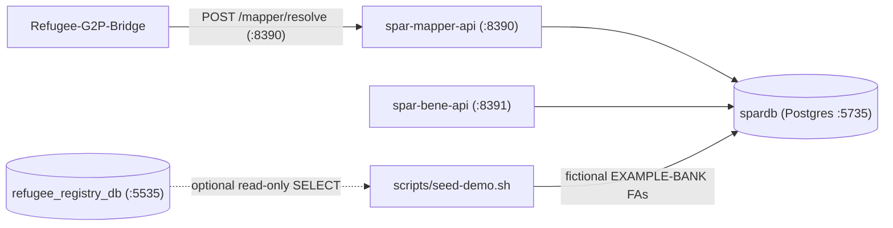

# Architecture

`Refugee-SPAR` is a standalone Docker Compose stack (`COMPOSE_PROJECT_NAME=refugee-spar`) with its own network (`refugee_spar_net`) and volume (`refugee_spar_postgres_data`).

## Components
- **Vendored source**: `vendor/spar/{models,mapper-core,mapper-partner-api,bene-portal-api}` (copied from `openg2p-workspace/spar` commit `d47e6af`).
- **Bootstrap (`spar-init`)**: Runs Alembic/SQLAlchemy migrations (`main.py migrate`) and idempotently seeds `strategy` rows (`1`, `2`, `5`) via `docker/spar-init/01-strategies.sql`.
